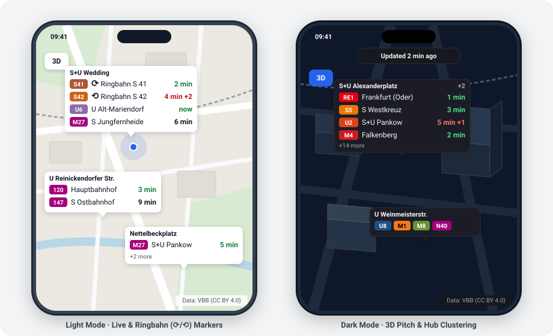
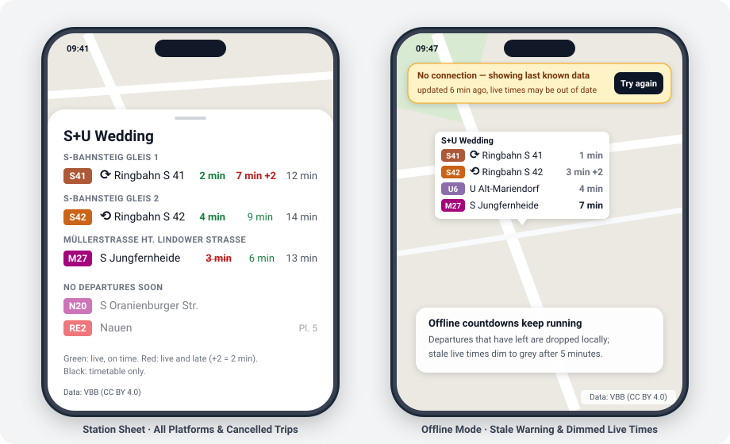
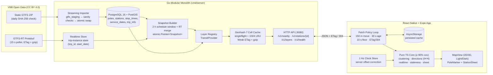

# LiveStop

> Working name. Repository: `punktchen`.

A map-first mobile app that shows **live departures** (regional rail, S-Bahn, U-Bahn, tram, bus, ferry) directly on the stops around you in Berlin and Brandenburg. Open the app, see the stops within ~500 m, each with its next departures per direction counting down live on the map.

**Status:** MVP complete (Phases 0–7). The Go backend imports the full VBB static GTFS feed into PostgreSQL/PostGIS, merges live GTFS-RT delays every 15 s into an immutable in-memory snapshot, and serves geohash-cached responses with ETags. The React Native (Expo) app renders zoom-clustered live markers, Ringbahn (`⟳`/`⟲`) and terminal-filtered directions, a 3D building pitch toggle, full light/dark themes, VoiceOver labels, and offline countdown resilience. See [`docs/PROGRESS.md`](docs/PROGRESS.md).

## Preview





## Why

Departure boards are usually one stop at a time, behind a search. LiveStop puts all of them on the map at once so you can compare walking to the bus stop across the street vs. the U-Bahn entrance around the corner at a glance.

It is also an engineering portfolio project focused on **backend scalability** and **resilient mobile state**:

- **Constant upstream load:** one shared poller per upstream feed (`≤ 6 req/min` for GTFS-RT, daily SHA-256 check for static GTFS), so upstream traffic never grows with connected users.
- **Lock-free reads:** an immutable, versioned in-memory snapshot of the 2-hour schedule + realtime window swapped via `atomic.Pointer` ([ADR-0005](docs/adr/0005-in-memory-snapshot.md)).
- **Zero-downtime daily imports:** streaming CSV import (~18 MB peak Go heap) into a staging schema followed by sanity checks and an atomic schema rename inside one transaction ([ADR-0004](docs/adr/0004-staging-schema-swap.md)).
- **Spatial coalescing & caching:** requests snap to precision-7 geohash cells (~153 m × 153 m) with singleflight build coalescing, a 1024-entry LRU cache, weak ETags (`304 Not Modified`), and gzip ([ADR-0006](docs/adr/0006-geohash-cell-cache.md)).
- **Offline-capable countdowns:** the API sends absolute ISO-8601 timestamps (`scheduled`, `predicted`) and `generatedAt`; the device computes countdowns against a server-corrected clock, persists the latest response in `AsyncStorage`, drops departed trips locally, and dims stale live times after 5 minutes ([ADR-0007](docs/adr/0007-countdown-on-device.md)).
- **Contract-first API & generic layers:** `api/openapi.yaml` drives generated Go server types (`oapi-codegen`), TypeScript client types (`openapi-typescript`), and runtime contract tests (`kin-openapi`) behind a layer-agnostic `Provider` interface ([ADR-0003](docs/adr/0003-openapi-contract-first.md), [ADR-0008](docs/adr/0008-provider-layer-system.md)).

## Architecture



```
VBB GTFS (daily)   ──► streaming import ──► PostgreSQL + PostGIS ──┐
                                                                   ├──► Snapshot (atomic.Pointer) ──► Geohash-7 LRU Cache ──► /v1/nearby ──► Mobile App
VBB GTFS-RT (15 s) ──► trip-instance store ────────────────────────┘
```

### Key design decisions

| ADR | Decision | Summary |
|---|---|---|
| [0001](docs/adr/0001-tech-stack-and-monorepo.md) | Tech stack & monorepo | Go 1.24, PostgreSQL 16 + PostGIS, React Native + Expo (TypeScript) in one repository |
| [0002](docs/adr/0002-modular-monolith.md) | Modular monolith | One Go binary (`cmd/server`) runs the importer, GTFS-RT poller, snapshot builder, and HTTP server |
| [0003](docs/adr/0003-openapi-contract-first.md) | Contract-first OpenAPI | `api/openapi.yaml` is the single source of truth; Go and TS types are generated and checked in CI |
| [0004](docs/adr/0004-staging-schema-swap.md) | Staging schema swap | Static GTFS imports into `gtfs_staging`, validates row counts, and swaps schemas atomically |
| [0005](docs/adr/0005-in-memory-snapshot.md) | Immutable snapshot | Readers load `atomic.Pointer[Snapshot]` with zero locks; builders publish a fresh copy per tick/feed |
| [0006](docs/adr/0006-geohash-cell-cache.md) | Geohash cell cache | Coordinates snap to precision-7 geohash cells expanded by ~90 m; `If-None-Match` returns `304` |
| [0007](docs/adr/0007-countdown-on-device.md) | Countdowns on device | Server sends absolute timestamps; device ticks at 1 Hz and re-renders markers only when a label changes |
| [0008](docs/adr/0008-provider-layer-system.md) | Generic layer system | Backend `Provider` and mobile `MapLayer<T>` registries decouple the map from transit-specific logic |
| [0009](docs/adr/0009-postgis-for-spatial.md) | PostGIS spatial queries | `ST_DWithin` on `GEOGRAPHY(Point, 4326)` with a GIST index (~2.8 ms median for 500 m at Wedding) |

Full specifications: [`docs/ARCHITECTURE.md`](docs/ARCHITECTURE.md), [`docs/DATA_MODEL.md`](docs/DATA_MODEL.md), [`docs/PLAN.md`](docs/PLAN.md), [`docs/PROGRESS.md`](docs/PROGRESS.md).

## Performance

Measured on the dev machine (Windows, backend and PostGIS in Docker Compose) on Tuesday 2026-11-10, 08:04–08:09, the morning peak: 116,000 departures in the snapshot, live VBB realtime. Latency is measured on the same machine, without a network.

**Upstream.** One poller asks VBB 4 times a minute (limit: 7), whatever the number of users.

**One app.** The fetch policy ([`ARCHITECTURE.md` §4.2](docs/ARCHITECTURE.md)) decides when to ask:

| Situation | Requests per minute |
|---|---|
| Standing still, app open | 2 (data older than 30 s) |
| Moving, departures leaving, errors | at most 6 (never within 10 s of the last request) |
| App in the background | 0 |

**The server under 1000 apps.** `nearbyload` simulates apps standing still: one request every 30 s each, with the ETag of the last answer and gzip. Two runs of 2 minutes, 33 requests per second:

| | A crowd: 1000 apps within 300 m | Spread out: 1000 apps within 3 km |
|---|---|---|
| Cache cells used | 30 | 787 |
| Requests | 3,999 | 3,999 |
| Cell cache hit ratio | **93.5 %** | 13.0 % |
| Answers built | 257 | 3,459 |
| Latency of a 200 (p50 / p95) | 2.3 ms / 5.7 ms | 4.1 ms / 6.9 ms |
| Answer size, gzip (median) | 6.5 KB | 2.8 KB |
| 304 Not Modified | 0.6 % | 0.6 % |

What the numbers say:

- **The cache works where people are.** A crowd shares a few cells, and 93.5 % of its lookups are answered from the cache. People spread over the city rarely share a cell, but a miss is cheap: one indexed PostGIS query plus a lookup in the in-memory snapshot, about 4 ms.
- **A burst costs one build.** 1000 requests for one cell at the same moment build the answer once; the others wait for it (`TestNearbyLoad`).
- **304s are rare while realtime flows.** Every applied VBB feed makes a new snapshot version (every 14 s in these runs), and the ETag follows the version, so an app that asks every 30 s almost always gets new data. When VBB's feed paused (around midnight), the version changed once a minute and 50 % of the requests were 304s. An ETag from the content of a cell would do better; that is not built.
- **gzip saves about 91 %.** Alexanderplatz, 500 m: 74.7 KB → 6.5 KB. Wedding: 32.3 KB → 2.9 KB.
- **Snapshots are cheap to rebuild.** Loading the whole 2-hour window from the database: 1.9 s (at start and after an import). Moving the window each minute: 111 ms. Merging a new realtime feed into 116,000 departures: 46 ms. Readers never wait: a new snapshot replaces the old one atomically.
- **Memory:** about 250 MB for the backend at the morning peak.

Run it yourself against the Compose stack:

```powershell
go -C backend run ./internal/tools/nearbyload -users 1000 -spread 300
go -C backend run ./internal/tools/nearbyload -users 1000 -spread 3000
```

## Repository layout

| Path | Content |
|---|---|
| `api/` | `openapi.yaml` — the OpenAPI 3.0 contract |
| `backend/` | Go server (`cmd/server`, `internal/{api,cache,layer,platform,transit}`, `db/{migrations,queries}`, `gen/`) |
| `mobile/` | Expo app (`app/` routes, `src/core/` pure TS domain logic, `src/layers/` map layers, `src/ui/` screens & tokens) |
| `docs/` | `PLAN.md`, `ARCHITECTURE.md`, `DATA_MODEL.md`, `PROGRESS.md`, `adr/`, `assets/` |

## How to run

Requirements: Docker Desktop (WSL2 on Windows), Go, Node.js (LTS or newer), Expo Go on your phone + a free Expo account.

**Backend + database** (PowerShell, from the repo root):

```powershell
Copy-Item .env.example .env        # optional; defaults work for local dev
docker compose up -d --build --wait
curl.exe http://localhost:8080/v1/health
```

- API: `http://localhost:8080` (reachable from the LAN for the phone)
- Metrics: `127.0.0.1:9090`, Postgres: `127.0.0.1:5432` (localhost only)
- All settings: [`.env.example`](.env.example)
- Stop: `docker compose down` (data stays in the `livestop_pgdata` volume; `down -v` deletes it)

### Run the app on your phone

The app runs in **Expo Go** and talks to the backend on your PC over the local network. No cable needed.

1. **Start the backend** (see above). Check: `curl.exe http://localhost:8080/v1/health`.
2. **Find the PC's LAN IP.** Run `ipconfig` and take the IPv4 address of the Wi-Fi adapter ("Wireless LAN adapter WLAN", e.g. `192.168.178.29`). Ignore `vEthernet`, `VMware` and `WSL` adapters.
3. **Point the app at it:**
   ```powershell
   Copy-Item mobile\.env.example mobile\.env
   # edit mobile\.env:  EXPO_PUBLIC_API_URL=http://192.168.178.29:8080
   ```
   Android emulator: use `http://10.0.2.2:8080` (the emulator's alias for the PC). `mobile/.env` is not committed.
4. **Same Wi-Fi.** Phone and PC must be on the same network — not a guest Wi-Fi, which isolates devices.
5. **Firewall.** Test from the phone's browser: `http://<PC-IP>:8080/v1/health` must show JSON.
   - Docker Desktop normally adds an inbound rule ("Docker Desktop Backend"), so this works out of the box.
   - If it times out, mark the home network as **Private** (Settings → Network & internet → Wi-Fi → network properties) and allow port 8080 there (PowerShell as admin):
     ```powershell
     New-NetFirewallRule -DisplayName "LiveStop API 8080" -Direction Inbound -Protocol TCP -LocalPort 8080 -Action Allow -Profile Private
     ```
   - Expo's dev server (Metro, port 8081) runs as Node.js; allow it when Windows asks on the first `expo start`.
6. **Expo account.** Expo Go only opens projects when the same (free) Expo account is signed in **in Expo Go and in Expo CLI** (`npx expo whoami`).
   - On Windows, the browser login of `npx expo login` may crash (the CLI passes the login URL unquoted to `cmd start`). Use `npx expo login --no-browser` (accounts with a password) or an access token from expo.dev in `$env:EXPO_TOKEN` (also works for Google/GitHub sign-ups). Never commit the token.
7. **Start Expo** and scan the QR code with the iPhone camera:
   ```powershell
   cd mobile
   npm install
   npx expo start
   ```
   The start screen shows **Backend: ok** with the server version and time. "Backend unreachable" means steps 2–5; "Backend not configured" means step 3.

`EXPO_PUBLIC_*` values are compiled into the bundle: after changing `mobile/.env`, restart with `npx expo start --clear`. Do the same after `npm install` — a running Metro server does not see newly installed packages ("Unable to resolve module …").

Mobile checks: `cd mobile; npm run typecheck; npm run lint; npm test`. After changing `api/openapi.yaml`: `npm run gen:api`. All commands: [`CLAUDE.md` §5](CLAUDE.md#5-commands).

### Offline check (airplane mode)

What the app does without a connection ([ARCHITECTURE §4.3](docs/ARCHITECTURE.md)). In Expo Go the JavaScript comes from the PC, so open the app before cutting the connection.

1. Open the app on Wi-Fi and wait for the departures.
2. Turn on airplane mode (Wi-Fi off as well). Within about 35 s a line at the top says **No connection — showing last known data**, with "updated just now" and a "Try again" button. Markers and countdowns stay and keep counting.
3. Wait. The second line counts up ("updated 3 min ago"). After 5 minutes it adds "live times may be out of date", and green and red times turn grey on the markers and in the station sheet; black timetable times stay as they are.
4. Turn airplane mode off and tap "Try again" (or wait up to a minute): the line goes away and the colours return.
5. Cold start without a backend: `docker compose stop backend`, force-quit the app and open it again. The map shows the last departures at once, then the "No connection" line within a few seconds. `docker compose start backend` brings it back.

## Data & licence

- Transit data: [VBB](https://www.vbb.de/) GTFS and GTFS-RT, licensed **CC BY 4.0**. Data: VBB (CC BY 4.0).
- Code: [MIT](LICENSE).
